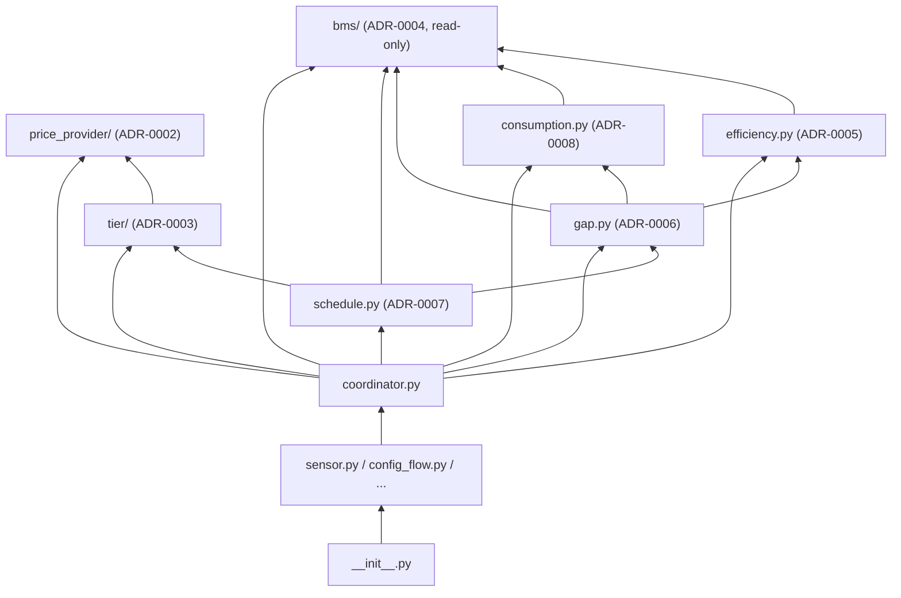

# ADR-0001 – Chargy Project Conventions: Identifiers, Module Layout, Version Targets

**Date:** 2026-09-20 **Status:** Draft **Revised:** 2026-10-05

---

## Context

ADR-0000 defines project-independent engineering conventions using `<project>` /
`<Project>` placeholders and deliberately contains no concrete module diagram or
version numbers. This ADR is Chargy's companion document that fixes those
placeholders concretely, and is the single place where Chargy's own identifiers,
current (provisional) module layout, and version targets are recorded — so
ADR-0000 itself never needs editing when any of these change.

---

## Decision

### 1 — Project identifiers

- Package: `custom_components/chargy/`
- Entity-class prefix: `Chargy` — e.g. `ChargySensor`, `ChargyCoordinator`,
  `ChargyConfigFlow`, `ChargyOptionsFlow` (per ADR-0000 §5).
- Tooling invocation (per ADR-0000 §1):
  `mypy custom_components/chargy tests --config-file mypy.ini`.

### 2 — Minimum supported Python / Home Assistant version

Adopted from the sibling project Shady's current config: **Python ≥3.14**,
**Home Assistant ≥2026.3.1** (`pyproject.toml`'s `requires-python`,
`[tool.mypy] python_version`, and `hacs.json`'s `homeassistant` key all set
accordingly, per ADR-0000 §4). Taken as a reasonable starting point since Chargy
runs in the same environment as Shady, not independently re-derived — worth
revisiting if Chargy's actual deployment target ever diverges from Shady's.

### 3 — Module boundaries and dependency direction (provisional)

The concrete shape, based on the capabilities identified so far
(`adr/adr-capability.md`), before any of it has actually been built:

`consumption` reads the BMS adapter for the per-phase grid-sensor entity IDs
(ADR-0008 §5, ADR-0004 §1), `schedule` for the cached max charge power (ADR-0007
§2). Neither `consumption` nor `efficiency` has an edge to the recorder: history
reaches them through the `fetch_fn` the coordinator injects (§6).

**This diagram is a planning sketch, not an implemented contract.** It must be
corrected by amendment once real modules exist and diverge from it — the same
discipline `adr/INDEX.md` enforces for ADR status changes (ADR-0000 §7) applies
here too.

### 4 — Current pure / zero-mocking test tier (ADR-0000 §6)

As of this draft, expected to comprise: `tier/`, `gap.py`, `schedule.py`,
`efficiency.py`, `consumption.py`, and the base classes in `price_provider/` and
`bms/`. The explicit Home-Assistant-touching exceptions (ADR-0000 §3/§6) are the
concrete adapter implementations: `price_provider/tibber.py` (reads the picked
price entity from `hass.states` and calls the `tibber.get_prices` action,
ADR-0002 §5) and `bms/solakon.py` (reads `hass.states`). The HA-facing layer
(`coordinator.py`, `sensor.py`, `config_flow.py`, `__init__.py`) is tested with
the stub-and-`Fake*` convention of ADR-0000 §6; §7 names the shared support
modules.

### 5 — Shared configuration

- `CONF_WINDOW_DAYS = "window_days"`, `DEFAULT_WINDOW_DAYS = 28` (same key and
  default as the sibling project Shady) — how many days of recorder history the
  consumption profile (ADR-0008) and the efficiency estimation (ADR-0005)
  analyze. The recorder's own retention (`purge_keep_days`) must be at least
  this long; the deployment this project targets keeps 60 days.

### 6 — History access, update cadence, persistence (provisional)

- **`fetch_fn`:** history is read through
  `fetch_fn(sensor_id: str, start: datetime, end: datetime, statistic: str) -> list[float | None]`,
  one entry per 5-minute slot in `[start, end)`, `None` where the recorder holds
  nothing. `statistic` is `"mean"` for power/SoC-like sensors or `"sum"` for
  `TOTAL_INCREASING` counters, so counter resets are already absorbed by Home
  Assistant's own accumulation. `coordinator.py` supplies an implementation
  backed by the recorder's statistics API (the pattern Shady uses); the exact
  signature is fixed by the scaffold task, this is the shape consumers may rely
  on. Sensors read this way must carry a `state_class`, otherwise the recorder
  holds no statistics for them.
- **Cadence (provisional, to be refined by the coordinator task):** price data
  is polled hourly and at startup, the tier plan follows price updates (ADR-0003
  §3); a 5-minute tick at each slot boundary reads the live BMS state and
  recomputes the gap (ADR-0006 §4) and the charge plan (ADR-0007);
  history-derived statistics (ADR-0008, ADR-0005) are recomputed at startup and
  once per day shortly after local midnight.
- **No persistence layer in the MVP:** everything history-derived is rebuilt
  from the recorder at startup, so Chargy stores no cache of its own.

### 7 — Test support layout

Shared test support follows the sibling project Shady: `tests/support.py`
(direct-file-path module loader and an `asyncio.run` wrapper, ADR-0000 §6) and
`tests/support_ha.py` (the hand-written `homeassistant` stub plus the real
`Fake*` stand-ins). They are created by the scaffold task and extended by later
tasks, never duplicated per test file.

---

## Consequences

- **Pro:** ADR-0000 stays copy-paste-clean for any future sibling project — only
  this document needs editing as Chargy's own layout evolves.
- **Pro:** Every other Chargy ADR can reference a single, current source for
  "what does the module layout look like right now" instead of each carrying its
  own stale sketch.
- **Con:** Two documents (ADR-0000 plus this one) must be read together to get
  the full picture of a single convention.
