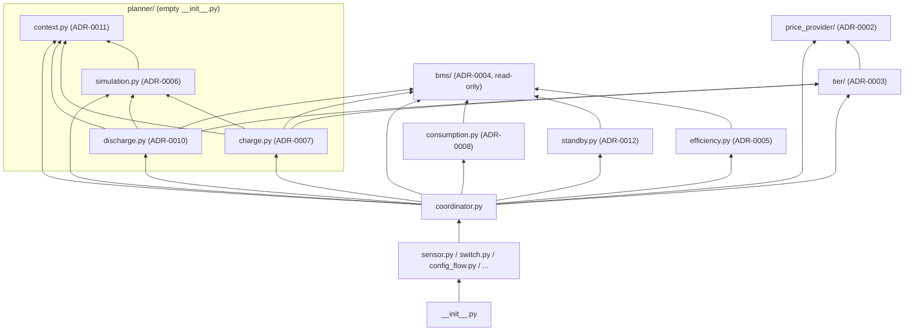

# ADR-0001 – Chargy Project Conventions: Identifiers, Module Layout, Version Targets

**Date:** 2026-09-20 **Status:** Draft **Revised:** 2026-10-12 (glossary
alignment: `planner/` package, `standby.py`, §8 vocabulary, §9 units)

---

## Context

ADR-0000 defines project-independent engineering conventions using `<project>` /
`<Project>` placeholders and deliberately contains no concrete module diagram or
version numbers. This ADR is Chargy's companion document that fixes those
placeholders concretely, and is the single place where Chargy's own identifiers,
current (provisional) module layout, and version targets are recorded — so
ADR-0000 itself never needs editing when any of these change.

---

## Decision

### 1 — Project identifiers

- Package: `custom_components/chargy/`
- Entity-class prefix: `Chargy` — e.g. `ChargySensor`, `ChargyCoordinator`,
  `ChargyConfigFlow`, `ChargyOptionsFlow` (per ADR-0000 §5).
- Tooling invocation (per ADR-0000 §1):
  `mypy custom_components/chargy tests --config-file mypy.ini`.

### 2 — Minimum supported Python / Home Assistant version

Adopted from the sibling project Shady's current config: **Python ≥3.14**,
**Home Assistant ≥2026.3.1** (`pyproject.toml`'s `requires-python`,
`[tool.mypy] python_version`, and `hacs.json`'s `homeassistant` key all set
accordingly, per ADR-0000 §4). Taken as a reasonable starting point since Chargy
runs in the same environment as Shady, not independently re-derived — worth
revisiting if Chargy's actual deployment target ever diverges from Shady's.

### 3 — Module boundaries and dependency direction (provisional)

The concrete shape, based on the capabilities identified so far
(`tasks/adr-capability.md`), before any of it has actually been built:

`consumption` reads the BMS adapter for the per-phase grid-sensor entity IDs
(ADR-0008 §5, ADR-0004 §1), `planner/charge` and `planner/discharge` for the SoC
floor/ceiling and the cached power limits (ADR-0006, ADR-0007, ADR-0010).
Neither `consumption`, `efficiency` nor `standby` has an edge to the recorder:
history reaches them through the `fetch_fn` the coordinator injects (§6). The
planners receive the standby power as an input (the coordinator resolves it:
configured value or `standby.py` estimate, ADR-0012), so `efficiency` and the
planners have no edge to `standby`.

**`planner/` is one package with an empty `__init__.py`.** `simulation.py` (the
slot-wise simulation and the gap, ADR-0006) imports `context.py` (`PlanContext`
and the `Planner` base, ADR-0011), and the two planners import both. Modules
import each other by full submodule path, never through the package namespace;
re-exporting from `__init__.py` would create an import cycle between
`simulation` and the planners.

**This diagram is a planning sketch, not an implemented contract.** It must be
corrected by amendment once real modules exist and diverge from it — the same
discipline `adr/INDEX.md` enforces for ADR status changes (ADR-0000 §7) applies
here too.

**Platforms:** Chargy provides the `sensor` and `switch` platforms
(`ChargyHolidaySwitch`, ADR-0009). `hacs.json`'s `domains` and `mypy.ini`'s
per-file suppressions (ADR-0000 §2) must list `switch` alongside `sensor`.

### 4 — Current pure / zero-mocking test tier (ADR-0000 §6)

As of this draft, expected to comprise: `tier/`, `planner/` (all four modules),
`efficiency.py`, `standby.py`, `consumption.py`, and the base classes in
`price_provider/` and `bms/`. The explicit Home-Assistant-touching exceptions
(ADR-0000 §3/§6) are the concrete adapter implementations:
`price_provider/tibber.py` (reads the picked price entity from `hass.states` and
calls the `tibber.get_prices` action, ADR-0002 §5) and `bms/solakon.py` (reads
`hass.states`). The HA-facing layer (`coordinator.py`, `sensor.py`,
`config_flow.py`, `__init__.py`) is tested with the stub-and-`Fake*` convention
of ADR-0000 §6; §7 names the shared support modules.

### 5 — Shared configuration

- `CONF_WINDOW_DAYS = "window_days"`, `DEFAULT_WINDOW_DAYS = 28` (same key and
  default as the sibling project Shady) — the length in days of the **history
  window**: the consumption averages and deviations (ADR-0008 §3), the
  efficiency estimation (ADR-0005) and the standby estimation (ADR-0012) analyze
  it. Unlike Shady's training window, which excludes the reference day, the
  history window ends now and includes today so far. A **day** is exactly 24
  hours (GLOSSARY.md). The recorder's own retention (`purge_keep_days`) must be
  at least this long; the deployment this project targets keeps 60 days.
- `CONF_BASELINE_DAYS = "baseline_days"`, `DEFAULT_BASELINE_DAYS = 7` — the
  length in days of the **baseline window**, used for baseline detection
  (ADR-0008 §1/§2): a full week, so a different weekend baseline cannot skew it.
  Kept separate from `window_days`.
- `CONF_PLANNER_ORDER = "planner_order"` — the planner order, `discharge_first`
  (default) or `charge_first` (ADR-0011).
- `CONF_SOFT_TARGET_SOC = "soft_target_soc"`, `DEFAULT_SOFT_TARGET_SOC = 80` (%)
  — the **soft target SoC** (ADR-0006 §2). Validated in the config flow to lie
  between Min SoC and Max SoC; re-clamped on every replan because the BMS values
  can be live. The default is a placeholder.

### 6 — History access, update cadence, persistence (provisional)

- **`fetch_fn`:** history is read through
  `fetch_fn(sensor_id: str, start: datetime, end: datetime, statistic: str) -> list[float | None]`,
  one entry per 5-minute slot in `[start, end)`, `None` where the recorder holds
  nothing, in the base units of §9 (`coordinator.py` converts from the sensor's
  own unit). `statistic` is `"mean"` for power/SoC-like sensors or `"sum"` for
  `TOTAL_INCREASING` counters, so counter resets are already absorbed by Home
  Assistant's own accumulation. `coordinator.py` supplies an implementation
  backed by the recorder's statistics API (the pattern Shady uses); the exact
  signature is fixed by the scaffold task, this is the shape consumers may rely
  on. Sensors read this way must carry a `state_class`, otherwise the recorder
  holds no statistics for them.
- **`fetch_flag_fn`:**
  `fetch_flag_fn(entity_id: str, start: datetime, end: datetime) -> list[bool | None]`
  — the same per-slot shape for on/off entities (the holiday switch, ADR-0009
  §3). Backed by the recorder's *state* history, since a switch has no
  statistics: a slot is `True` if the entity was `on` at any moment within it,
  `None` where the recorder holds no history.
- **Cadence (provisional, to be refined by the coordinator task):** price data
  is polled hourly and at startup, the tier timeline follows price updates
  (ADR-0003 §3); a 5-minute tick at each slot boundary reads the live BMS state
  and replans — re-derives the gap (ADR-0006 §4) and re-runs the planners in the
  planner order (ADR-0011); history-derived statistics (ADR-0008, ADR-0005,
  ADR-0012) are rebuilt at startup and once per day shortly after local
  midnight. Flipping the holiday switch (ADR-0009) re-derives the consumption
  statistics from the history already held and triggers an immediate replan.
- **No persistence layer in the MVP:** everything history-derived is rebuilt
  from the recorder at startup, so Chargy stores no cache of its own.

### 7 — Test support layout

Shared test support follows the sibling project Shady: `tests/support.py`
(direct-file-path module loader and an `asyncio.run` wrapper, ADR-0000 §6) and
`tests/support_ha.py` (the hand-written `homeassistant` stub plus the real
`Fake*` stand-ins). They are created by the scaffold task and extended by later
tasks, never duplicated per test file.

### 8 — Domain vocabulary

`GLOSSARY.md` at the repository root is the single authority for domain terms.
ADRs, identifiers, config keys, entity names and UI labels use its terms and
avoid the words it lists under _Avoid_. Terms shared with the sibling project
Shady (**Slot**, **Neighbor slot**, **Day**) are copied from Shady's glossary
word for word, so they mean the same in both repositories; the two glossaries
are otherwise independent. A change that introduces or redefines a domain
concept updates `GLOSSARY.md` in the same change.

### 9 — Units

- **Energy:** Wh everywhere in Chargy (stored energy, capacity, shortfall, gap,
  spill, per-slot PV and consumption energy).
- **Power:** W (max charge/discharge power, standby power, grid meter readings).
- **SoC:** %.
- **Prices:** €/kWh after the **price unit factor** (ADR-0002 §6) is applied;
  prices are only ranked and compared with tier cutoffs, so no price arithmetic
  involves Wh.
- Sensors reporting kWh, Wh, W or kW are normalised to these base units at the
  boundary — in the adapters (`bms/`, `price_provider/`) and in `fetch_fn` (§6)
  — as the sibling project Effy does (its ADR-002). A sensor whose unit cannot
  be converted is rejected in the config flow.

---

## Consequences

- **Pro:** ADR-0000 stays copy-paste-clean for any future sibling project — only
  this document needs editing as Chargy's own layout evolves.
- **Pro:** Every other Chargy ADR can reference a single, current source for
  "what does the module layout look like right now" instead of each carrying its
  own stale sketch.
- **Con:** Two documents (ADR-0000 plus this one) must be read together to get
  the full picture of a single convention.
